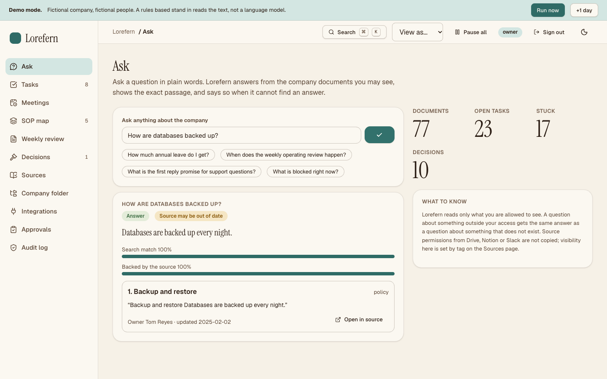

# Lorefern

A company brain and operations helper for a small company, set up by an implementer. Part of a set of seven free AI systems from Sendora. MIT licence.

- **Answers questions** from the company's own documents and shows the exact passage it used. When nothing supports an answer it says so, and when two documents disagree it shows both.
- **Turns meetings into tasks.** It proposes the action items and decisions with the exact words, and a person approves each one. Nothing becomes a task by itself.
- **Keeps work moving:** drafted reminders (sent only after a second person approves), stuck work, an SOP map of repeated work with no written procedure, a weekly review where every line links to its source, and a decision log.
- **Ships a company folder template** and a creator and a checker for it, so an implementer can set up a client's knowledge the way Lorefern reads best.
- **A hard visibility boundary.** Five tags, four audiences, filtered inside every query. Restricted looks the same as missing.

## Try it with made up data

See `docs/01-QUICK-DEMO.md`. You need Python 3.12, Node 22 and pnpm. No accounts, no keys, nothing leaves your computer.

## What was measured

All numbers come from `data/counts.json`, written by `tools/make_counts.py`.

| What | Result |
| --- | --- |
| Python tests | <!--n:tests.passed-->213<!--/n--> passed, <!--n:tests.skipped-->1<!--/n--> skipped, <!--n:tests.coverage_percent-->92.0<!--/n--> percent coverage |
| Browser tests | <!--n:e2e.tests-->30<!--/n--> tests (smoke, security, demo path, quality gates) |
| Pages | <!--n:pages-->11<!--/n--> |
| Screenshots | <!--n:screenshots-->39<!--/n--> at phone and desktop widths, in eight states |
| Seed company | <!--n:seed.company_files-->59<!--/n--> document files, <!--n:seed.meetings-->12<!--/n--> meetings, <!--n:seed.planted_tasks-->35<!--/n--> planted tasks, <!--n:seed.people-->10<!--/n--> people |
| Held out questions | <!--n:heldout_questions-->56<!--/n--> written before the code |
| Held out meetings | <!--n:seed.heldout_transcripts-->8<!--/n--> in other styles |
| Tools compared | <!--n:tools_scored-->28<!--/n--> in <!--n:tool_groups-->8<!--/n--> groups |

## Read this before you trust it

- The answer writer and the meeting reader are **rules, not a language model**. On the held out questions the first run got <!--n:eval.answers_first_run.correct-->22<!--/n--> of <!--n:eval.answers_first_run.of-->56<!--/n--> right and the version tuned afterwards <!--n:eval.answers_after_tuning.correct-->32<!--/n--> of <!--n:eval.answers_after_tuning.of-->56<!--/n-->, with no leak of restricted text. On held out meetings the first run found 60 percent of the action items and 0 of 3 decisions. See `docs/ANSWER-EVAL.md` and `docs/EXTRACTION-EVAL.md`.
- **Independent test sets** (written by people who never saw the code, offline rules): the first run on set A got <!--n:eval.independent.set_a_first_run.correct-->42<!--/n--> of <!--n:eval.independent.set_a_first_run.of-->79<!--/n--> answers right and on set B <!--n:eval.independent.set_b_first_run.correct-->65<!--/n--> of <!--n:eval.independent.set_b_first_run.of-->87<!--/n-->; restricted questions were refused cleanly <!--n:eval.independent.set_a_first_run.restricted_refused_clean-->7<!--/n--> of <!--n:eval.independent.set_a_first_run.restricted_of-->10<!--/n--> and <!--n:eval.independent.set_b_first_run.restricted_refused_clean-->9<!--/n--> of <!--n:eval.independent.set_b_first_run.restricted_of-->13<!--/n--> times, with no real leak (the other restricted questions were answered from other visible documents or refused with a string coincidence the tool flagged and a person checked). Action items found: <!--n:eval.independent.set_a_first_run.actions_matched-->16<!--/n--> of <!--n:eval.independent.set_a_first_run.actions_key-->25<!--/n--> (set A) and <!--n:eval.independent.set_b_first_run.actions_matched-->15<!--/n--> of <!--n:eval.independent.set_b_first_run.actions_key-->21<!--/n--> (set B). See `docs/INDEPENDENT-EVAL.md`.
- **A language model path exists and is UNVERIFIED live.** `LLM_BACKEND=anthropic` runs the answer writer, the meeting reader, process names and the review intro behind the same code checks; it is tested against a fake server (<!--n:eval.model_path_tests-->27<!--/n--> tests) and <!--n:eval.llm_fixtures-->29<!--/n--> recorded fixtures made by that fake server, never with a real key. The default is the offline rules and calls nothing. Vendor request shapes are checked by <!--n:eval.contract_tests-->9<!--/n--> contract tests. See `docs/facts/models.md`.
- **Lorefern does not copy the permissions of Drive, Notion or Slack.** You set a visibility tag per source. Read `docs/13-SECURITY-AND-DATA.md` first.
- **Single tenant:** one company per install.
- No real vendor was contacted while building this. Every connection was tested against a local imitation. `docs/FACTS-AND-SOURCES.md` lists what was read and what was not.

## Where to go

Start with `docs/00-START-HERE.md`. The tools it can connect to, with scored alternatives, are in `docs/TOOLS-AND-ALTERNATIVES.md`. Setting up a client's company folder: `docs/10-USING-IT-FOR-A-CLIENT.md` and `templates/company-folder/`. Prompts for Claude Code and Codex are in `prompts/`. Security notes: `SECURITY.md`.
