# Capabilities

What Lorefern does, with a picture of each page. Pictures are of the demo with made up data. Counts are from `data/counts.json`: <!--n:pages-->11<!--/n--> pages, <!--n:api_operations-->58<!--/n--> API operations, <!--n:tables-->14<!--/n--> tables.

## Ask, with sources

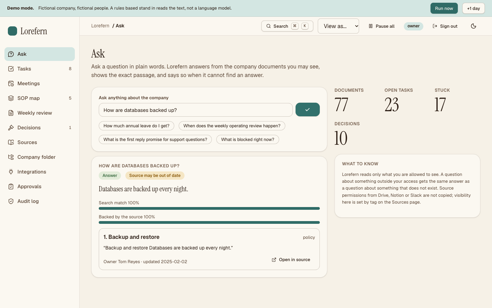

The answer, the passage it used, how well the search matched and how well each sentence is backed. Open in source shows the document with the passage marked.

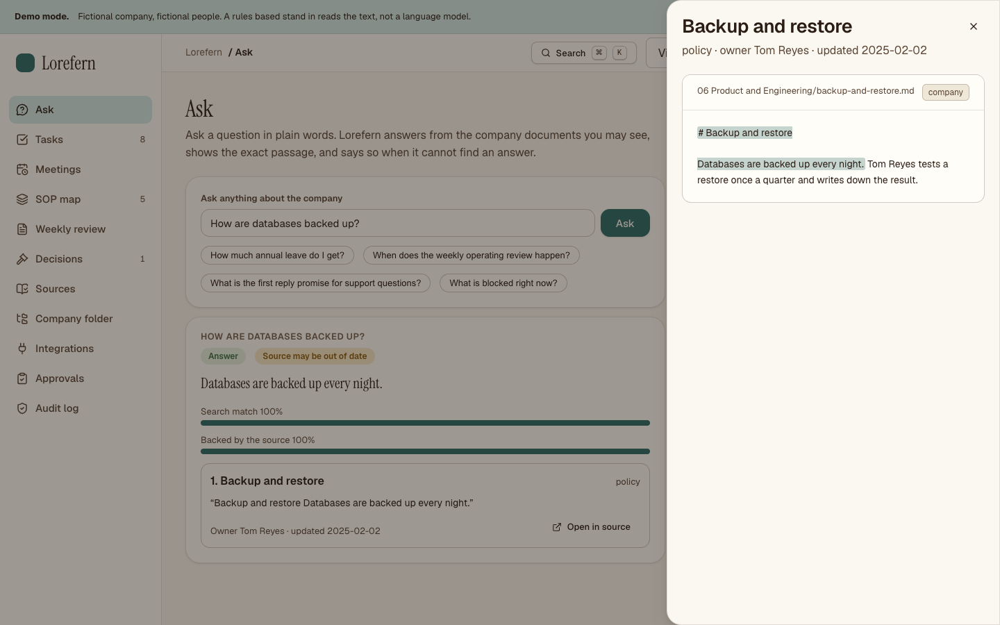

When two documents disagree, both are shown:

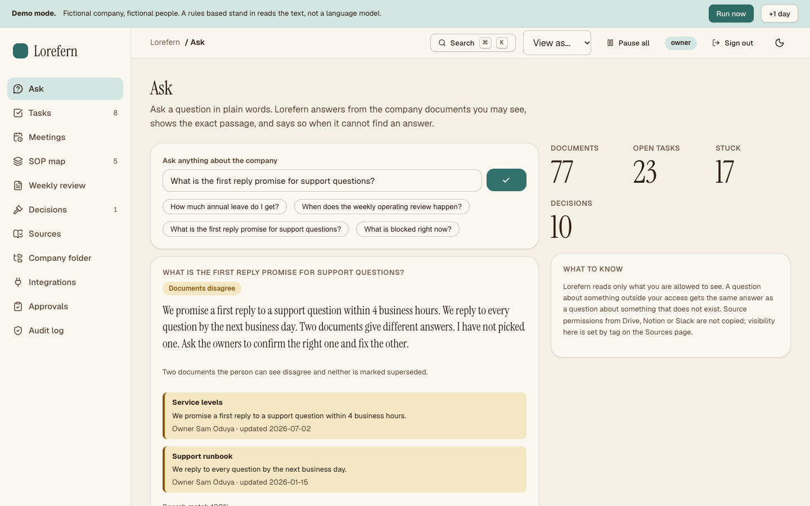

## Tasks from meetings, approved by a person

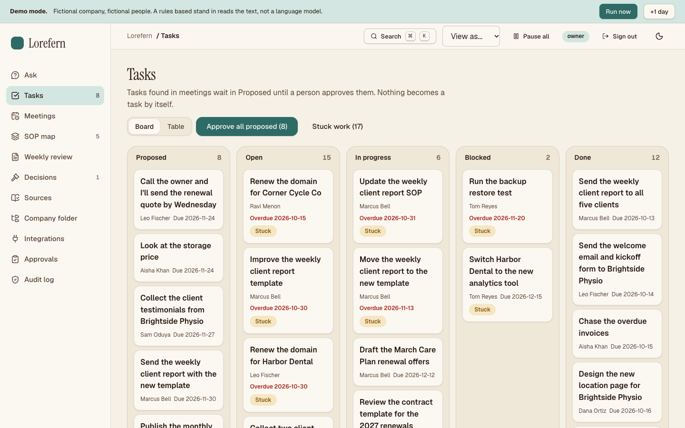

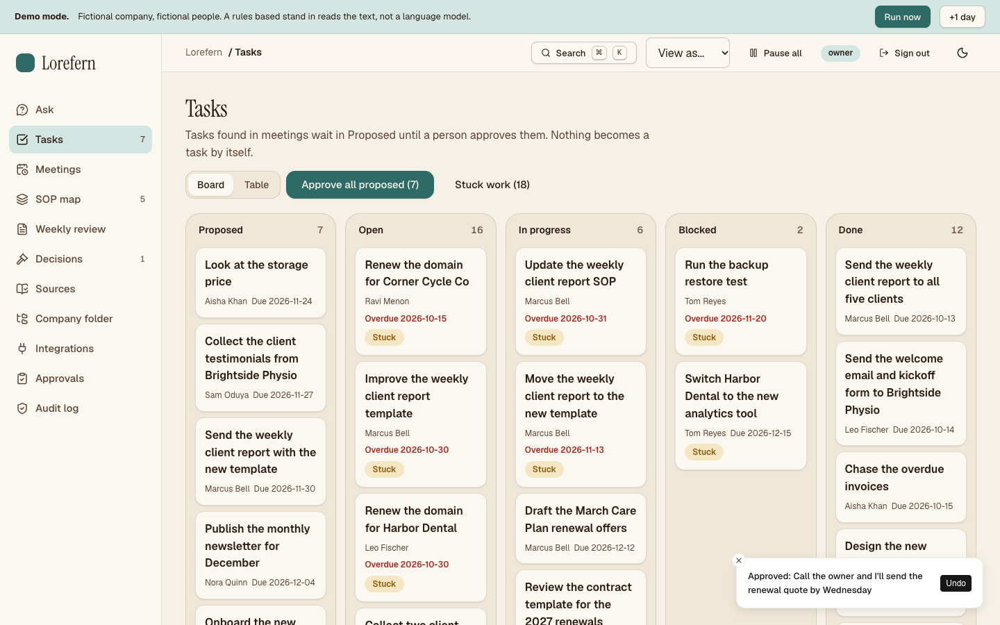

## Meetings, with the exact words marked

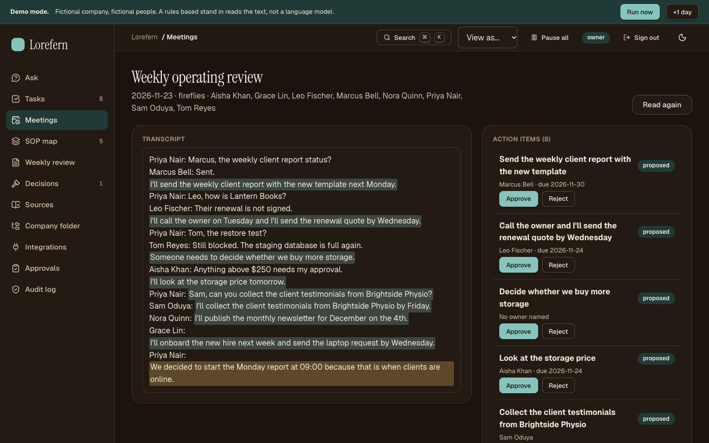

## SOP map

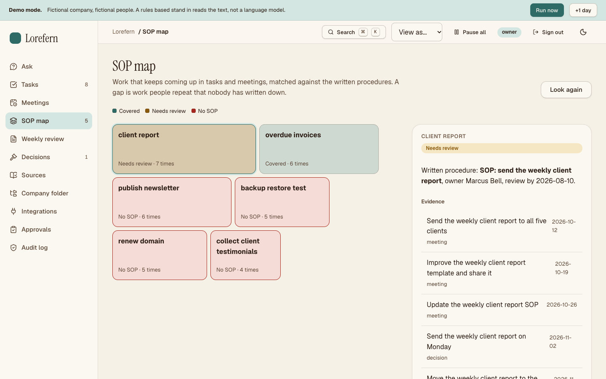

## Weekly review

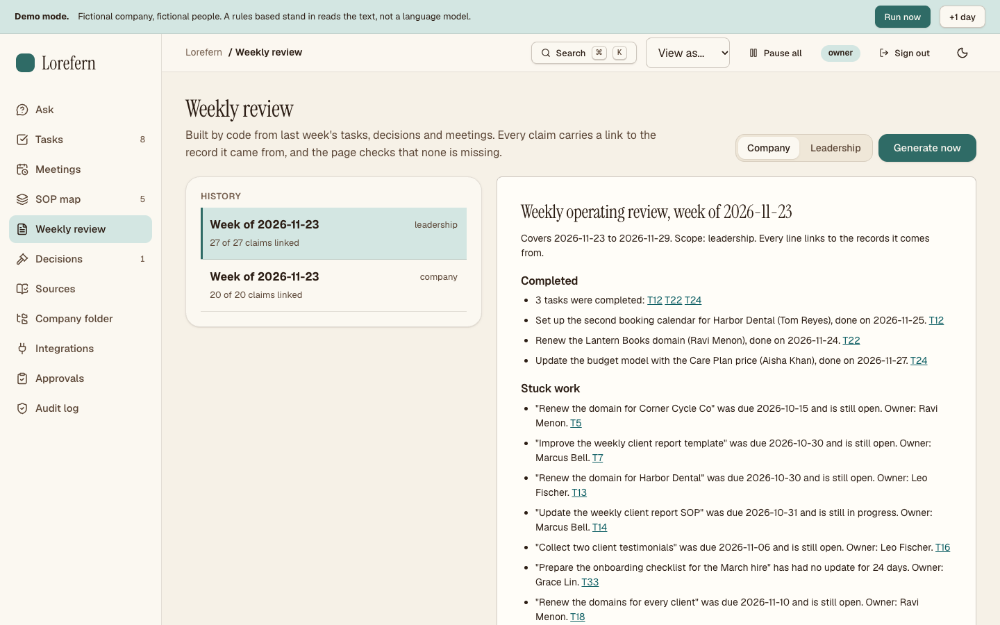

## Decisions, sources, company folder

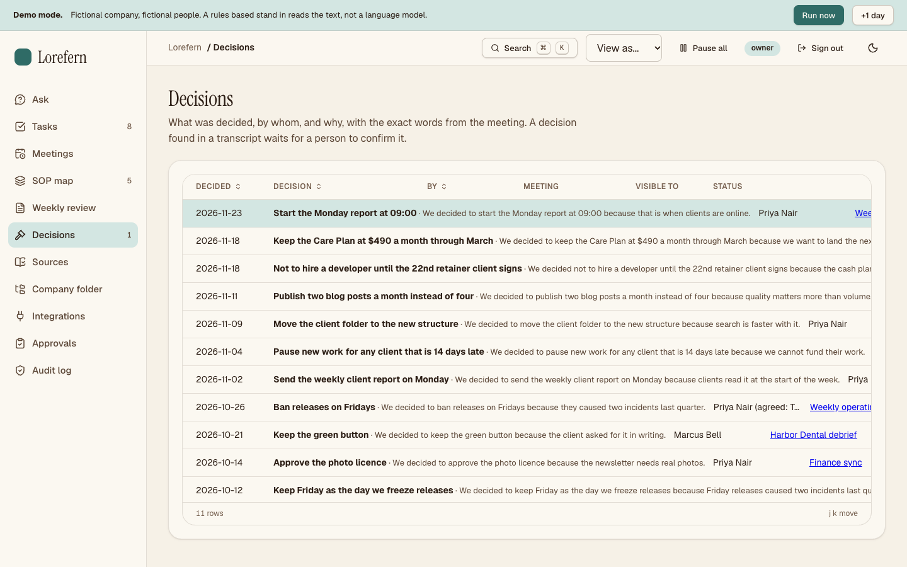

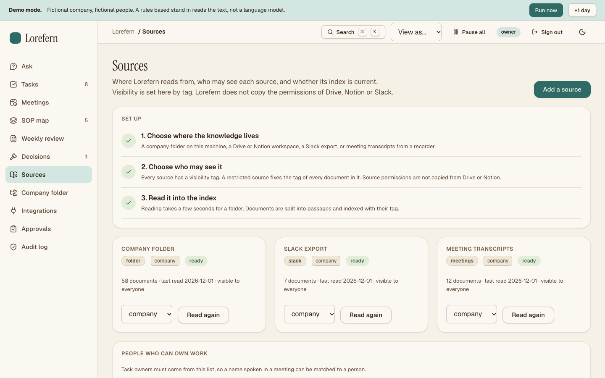

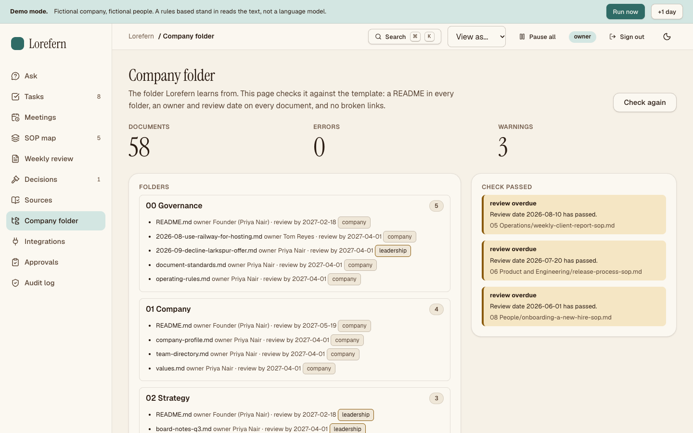

## On a phone

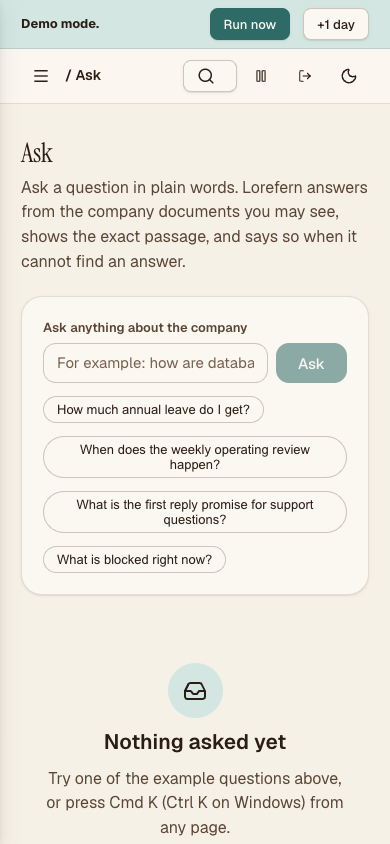

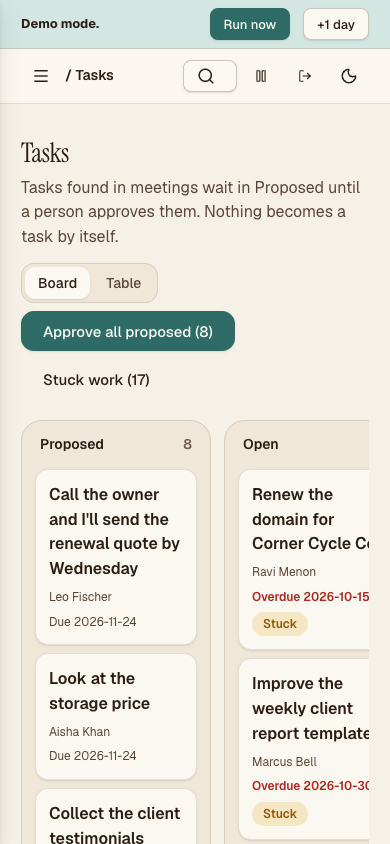

## States

Every page has a loading, empty and error state. The set below is the same at both sizes: default, detail, warning, a button while it works, a message with undo, empty, error and dark. See `screenshots/` (<!--n:screenshots-->39<!--/n--> images).

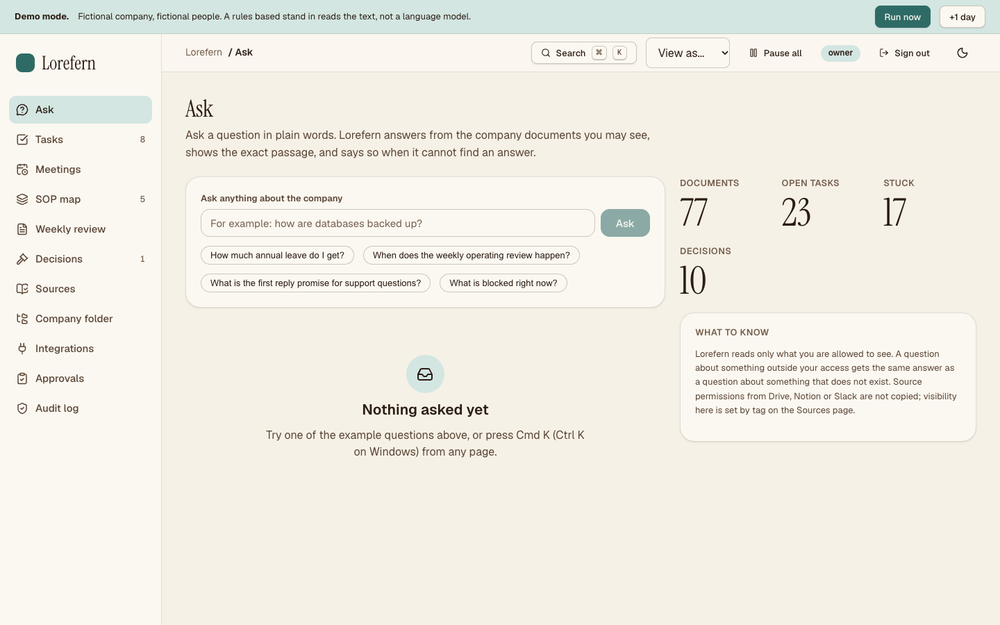

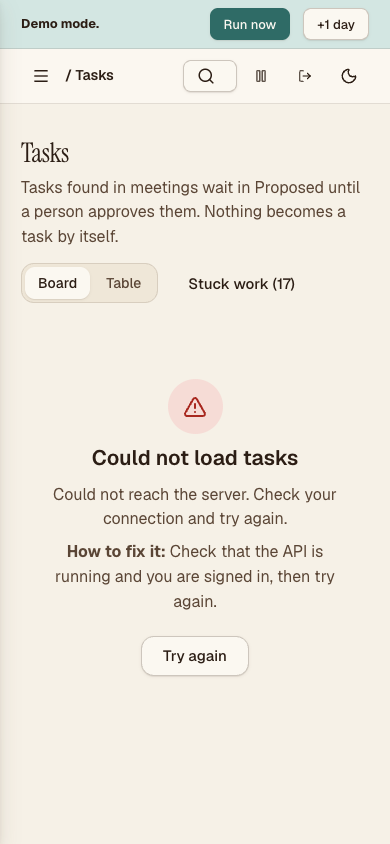

## What it does not do

See `14-LIMITS-AND-HONEST-NOTES.md`: rules instead of a language model, no per user source permissions, single tenant.
